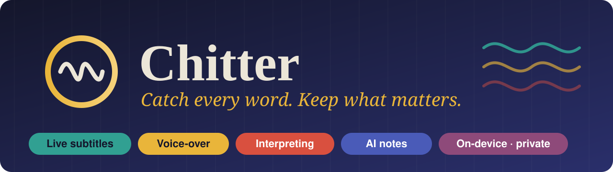

<div align="center">



# 📘 Chitter, explained

**Everything about the project in one place:** the simple explanation, how it works, the tech stack, where AI is used, the numbers, the business case, what changed over time, and ready-to-use resume and interview material.

</div>

---

## 📑 Contents

1. [The project in 60 seconds](#1--the-project-in-60-seconds)
2. [Simple explanation (no jargon)](#2--simple-explanation-no-jargon)
3. [Real-world use cases](#3--real-world-use-cases)
4. [How it works](#4--how-it-works)
5. [Tech stack: what and where](#5--tech-stack-what-and-where)
6. [Where AI is used, and which AI](#6--where-ai-is-used-and-which-ai)
7. [Numbers](#7--numbers)
8. [Achievements](#8--achievements)
9. [Business case](#9--business-case)
10. [Updates and timeline](#10--updates-and-timeline)
11. [STAR format for your resume and interviews](#11--star-format-for-your-resume-and-interviews)
12. [Honest status and limits](#12--honest-status-and-limits)
13. [Likely interview questions and honest answers](#13--likely-interview-questions-and-honest-answers)
14. [Glossary](#14--glossary)
15. [Where to find things in the repo](#15--where-to-find-things-in-the-repo)

---

## 1. ⏱️ The project in 60 seconds

| | |
|---|---|
| **Name** | Chitter |
| **Tagline** | *Catch every word. Keep what matters.* |
| **What it is** | Free, open-source software that makes calls understandable: live subtitles, foreign speech spoken to you in your language, your own voice interpreted into the call, and meeting notes where every decision links to the exact line it came from |
| **Two products** | 🍎 a native **Mac app** (Swift) and 🌐 a **Chrome extension** (JavaScript) that works on Windows, Linux, ChromeOS and Mac |
| **Key idea** | Hear the call **on your own device**. No meeting bot joins. By default nothing about your meetings leaves your computer |
| **AI** | Speech recognition, language detection, translation, note-writing and voice, all running **on-device** by default |
| **License** | Apache-2.0 (free to use, change and share) |
| **Repo** | https://github.com/Ayush277/chitter |

---

## 2. 🧒 Simple explanation (no jargon)

Imagine you are on a video call and a colleague starts speaking Spanish, and you only speak English.

**Without Chitter:** you miss most of it, ask them to repeat, and afterwards nobody remembers exactly what was agreed.

**With Chitter:**
1. It **notices the call started** and wakes up by itself.
2. It **listens** to what comes out of your speakers.
3. It **works out which language** is being spoken.
4. It **writes down** the words and shows them as **subtitles** on your screen.
5. It **translates** them and **says them out loud in English**, in a natural voice.
6. When the call ends, it writes **notes**: a summary, decisions and action items.
7. Every note has a small tag like *(L7)* that points to the **exact sentence** it came from, so you can check it instead of trusting a computer's word.

And all of this happens **on your own computer**. A built-in "Privacy Ledger" window shows every connection the app makes, and by default the answer is *"Nothing left your Mac."*

> **One-sentence version:** *Chitter is a private, on-device assistant that subtitles, translates and summarises your calls, and proves where every note came from.*

---

## 3. 🌍 Real-world use cases

| 👤 Who | 😣 Problem today | ✅ How Chitter helps |
|---|---|---|
| **Cross-border teams** (for example India–Europe–US) | Meetings mix languages; non-native speakers miss details | Subtitles plus an English voice-over; the speaker can switch language mid-call |
| **Students** | Lectures and webinars in a second language | Live captions and a searchable transcript with notes afterwards |
| **Deaf and hard-of-hearing people** | Many calls and videos have no captions | Captions on **any** audio, with an accessibility mode (large, high-contrast text, 28 pt or more) |
| **Lawyers, doctors, journalists, researchers** | Cannot send sensitive conversations to a cloud service | Everything runs locally; the ledger proves it |
| **Language learners** | Hard to follow native-speed streams | Original text with translation underneath |
| **Anyone who forgets** | "What did we decide?" | Notes with decisions and owners, each linked to its source line |
| **Remote interviews and customer calls** | Taking notes while talking hurts the conversation | Notes write themselves; nobody has to be told to invite a bot |

---

## 4. ⚙️ How it works

<div align="center"></div>

```text
🔊 call audio ─► capture ─► hear (speech to text + language ID) ─► translate ─► 🗨️ subtitles
                                      │                                  └────► 🔈 voice-over
                                      └─► 📁 meeting folder ─► 🧠 notes (with source lines) ─► 🔎 search / export
```

### The five steps
| # | Step | Mac app | Chrome extension |
|---|---|---|---|
| 1 | **Capture** | Core Audio *process tap* on the Mac's sound output | Hooks the page's WebRTC connection and takes each participant's audio track |
| 2 | **Hear** | Apple SpeechAnalyzer or Whisper | Chrome on-device `SpeechRecognition` |
| 3 | **Translate** | Apple Translation or Apple's on-device language model | Chrome `Translator` |
| 4 | **Speak and show** | System voice + floating subtitle ribbon | `speechSynthesis` + overlay |
| 5 | **Remember** | Plain files + SQLite search + notes | Markdown download + notes panel |

### Three clever design ideas
1. **Auto-start without a bot.** The Mac app asks the operating system which programs currently have the microphone open. A known call app or a browser with the mic open means *a call is happening*. A 12-second grace period means a brief mute isn't mistaken for hanging up.
2. **Speak sooner, not later.** As the live transcript grows, every finished sentence is translated and spoken **once**, before the speaker finishes talking. If voice-over falls behind it speeds up slightly (up to about 1.3×) and then **drops** the oldest line instead of drifting minutes behind.
3. **Notes you can audit.** The notes model must cite transcript line numbers. The app **rejects any item that cites a line that doesn't exist**, so the AI cannot invent its sources.

Full diagrams: [`docs/ARCHITECTURE.md`](docs/ARCHITECTURE.md)

---

## 5. 🧰 Tech stack: what and where

| 🧱 Layer | 🔧 Technology | 📍 Used for | 📂 Where |
|---|---|---|---|
| Language (Mac) | **Swift 6**, Swift Package Manager | The whole Mac app, 9 modules | `Sources/`, `Package.swift` |
| UI (Mac) | **SwiftUI**, **AppKit** | Notes window, Settings, Privacy Ledger, onboarding, menu bar, floating ribbon | `Sources/EchoUI`, `EchoApp` |
| Audio | **Core Audio**, **AVFoundation** | Capture, resampling, microphone, speech output | `Sources/EchoAudio`, `EchoVoice` |
| Call detection | **Core Audio** per-process flags | Spots which app or browser tab is in a call | `EchoAudio/CallDetector.swift` |
| Search | **SQLite FTS5** | Full-text search that tolerates misspellings | `EchoCore/SearchIndex.swift` |
| Secrets | macOS **Keychain** | Optional API keys | `EchoCore/Keychain.swift` |
| Integrity | **CryptoKit** | Verifying the optional installer's checksum | `EchoVoice/BlackHoleInstaller.swift` |
| Browser | **JavaScript**, **Manifest V3**, WebRTC, Shadow DOM | The Chrome extension | `extension/` |
| Web | Plain **HTML + CSS + JS** | The website (about 25 KB, no framework) | `site/` |
| Video | Swift + **WebKit** + AVFoundation | Renders the demo videos to MP4 | `video/` |
| Tests | **Swift Testing**, in-browser JS tests | Quality checks | `Tests/`, `extension/test/` |
| Scripts | Shell, Python | Build, package, benchmark | `scripts/` |
| Third-party code | **WhisperKit** (MIT) | Whisper speech recognition in Swift | `EchoASR` |

**Why this stack:** native Swift is the only way to reach Core Audio taps and Apple's on-device AI efficiently; plain JavaScript keeps the extension and site auditable with nothing to install; and only **one** third-party Swift library keeps licensing simple.

More detail: [`docs/TECH_STACK.md`](docs/TECH_STACK.md)

---

## 6. 🤖 Where AI is used, and which AI

> **Rule of the project:** AI runs **on the device** by default. Cloud AI is optional, off, and needs your own key.

### 6.1 The AI map

| 🧠 Job | 🍎 Mac app | 🌐 Chrome extension | 📍 Runs |
|---|---|---|---|
| **Speech to text** | **Apple SpeechAnalyzer** (macOS 26+) or **OpenAI Whisper** via WhisperKit | Chrome built-in `SpeechRecognition` (`processLocally`) | On your device |
| **Language detection** | **Whisper** per utterance; **NaturalLanguage** text check; a safeguard re-checks implausible results such as Spanish heard as Latin | Chrome `LanguageDetector` + a confidence probe that tries your candidate languages | On your device |
| **Translation** | **Apple Translation** language packs, then **Apple's on-device language model** as a fallback that needs no download | Chrome `Translator` | On your device |
| **Notes** | **Apple on-device language model** → **Ollama** (local) → your own API key (Gemini, Groq, OpenRouter, custom) → offline rule-based extractor | Chrome `LanguageModel` (Gemini Nano) → offline rule-based extractor | On your device by default |
| **Voice** | macOS speech synthesis, picking the best installed voice (Premium, then Enhanced, then standard) | Browser `speechSynthesis`, preferring natural local voices | On your device |

### 6.2 Where AI is **not** used (on purpose)
Audio capture, call detection, voice-activity detection, search, storage, export, the Privacy Ledger, the interface and every safety check are **ordinary, testable code**. The notes also have a **non-AI fallback** (a rule-based extractor), so the app still produces notes with no model at all.

### 6.3 Making AI trustworthy
| Risk | Defence |
|---|---|
| Model returns broken output | Notes must be JSON; the app validates, retries once with a repair prompt, then falls back |
| Model invents sources | Items citing non-existent transcript lines are dropped |
| Model or service unavailable | Every AI step has a fallback chain ending in plain code |
| Free tiers rate-limit | Exponential back-off, then the next provider |
| Long meetings overflow the model | Map-reduce: summarise chunks, merge, keep line IDs |
| Sensitive data | Cloud providers are opt-in; only **text** (never audio) is sent; every request is listed in the ledger |

### 6.4 AI results measured in this project
| Test | Result |
|---|---|
| Speech accuracy, 11.5 s English clip | **2.6%** word error rate (both Apple and Whisper base) |
| Notes from a sample meeting (Apple on-device model, no API key) | Every decision and action cited a real transcript line (valid-reference share 1.0) |
| Foreign speech → English voice, warm model, 6–8 s clips | **Chinese, Japanese, French, Spanish** each detected, translated and voiced in **3.8–6.2 s** |
| Translation with Apple's on-device model | **1.4–2.0 s** per sentence once warm; **~6 s** on the very first call while the model loads |
| Language detection on 5 test languages | 4 of 5 at first (Spanish misread as Latin), then fixed by the safeguard |

---

## 7. 🔢 Numbers

### 7.1 Size of the project (counted from the repo)
| Metric | Value |
|---|---|
| Swift source | **3,928 lines** in **47 files**, **9 modules** |
| Swift tests | **432 lines**, **48 tests** |
| Chrome extension (code + tests) | **651 lines** of JavaScript, **13 browser checks** + a WebRTC smoke test |
| Website | **274 lines** (HTML, CSS, JS), about **25 KB** |
| Documentation | **739 lines** of Markdown across the repo |
| Interface strings | **90** in a localisation catalog (English complete; ES / ZH / JA / KO stubs marked "needs review") |
| Scripts | **10** (build, test, package, bench, fixtures, release…) |
| Tracked files | **163** |
| Commits | **17** |
| Logged design decisions | **18** in `DECISIONS.md` |

Lines per module: `EchoUI` 1,025 · `EchoApp` 883 · `EchoCore` 503 · `EchoAudio` 352 · `EchoASR` 283 · `EchoNotes` 281 · `EchoVoice` 276 · `EchoNet` 191 · `EchoLang` 134.

### 7.2 Performance (one Mac: Apple silicon, macOS 27.0.1)
| Metric | Result | Note |
|---|---|---|
| App size | **9.8 MB** | AI models download on demand |
| Cold start | **0.07 s** | launch to ready, then exit |
| Soak test | **30 minutes, 584 sentences, no crash** | looped test audio |
| Process CPU during soak | **0.9% average** | Chitter's own process only |
| Process memory during soak | **8–23 MB** | excludes Apple's separate speech process |
| First subtitle | Apple **4.1 s**, Whisper **2.0 s** | target of 1.5 s **not met** |
| Voice-over end to end (warm) | **3.8–6.2 s** | per 6–8 s clip |

> ⚠️ The CPU and memory figures cover Chitter's own process only. Apple's speech recogniser runs in a separate system process that isn't included, so real total load is higher.

### 7.3 Price and privacy
| | |
|---|---|
| Cost to run (default setup) | **$0.00** per meeting hour |
| Meeting data sent off the device (default) | **0 bytes** |
| Accounts, analytics, servers | **None** |
| Third-party Swift libraries | **1** (WhisperKit, MIT) |
| Extension permissions | **2** (`storage`, `scripting`) |

---

## 8. 🏆 Achievements

**Engineering**
- Built a **complete native macOS app** and a **Chrome extension** around one architecture, plus a website, packaging scripts and demo videos.
- Reached **real, measured results** on real audio: 2.6% word error rate, a 30-minute soak test with no crash, and four languages translated to a spoken English voice.
- Wrote **48 Swift tests and 13 browser checks**, including tests that enforce *design rules*: "no code outside one module may use the network" and "no extension file may make a network request".
- Found and fixed a real bug through testing: the extension crashed on Google Meet because Meet forbids a kind of page code; I reproduced it in a test with the same rule and added a regression test.
- Solved a **toolchain problem** (an unreliable test plugin on a minimal developer toolchain) with an explicit configuration instead of retries.

**Product and design**
- **Auto-start on calls** in native apps and browser tabs with no extension and no extra permission.
- **Pull the Thread**: an interface that draws a line from each AI note to its source sentence, so AI output can be checked.
- A **Privacy Ledger** that makes "private" something a user can verify.
- Accessibility mode, a colour-contrast test that caught and fixed two failing colours, and a localisation scaffold for four more languages.

**Honesty and process**
- Every check result, including failures, is recorded in `docs/PROGRESS.md`; every judgement call in `DECISIONS.md`.
- Targets that were **not met** are stated in the README instead of hidden.

---

## 9. 💼 Business case

*These are reasoning and ideas, not measured results.*

### 9.1 The gap
Most meeting-AI products are **cloud-based**, **bot-based** or **paid**. A free, local-first, source-linked alternative sits in a clear position. Related open-source projects exist (for example Meetily, Hyprnote, OpenOats and Cicada), so differentiation matters.

### 9.2 Differentiators
| Differentiator | Why it matters |
|---|---|
| **No bot**, works with any call app | Nobody has to be invited or asked for permission to add a bot |
| **On-device by default** | Privacy, no running cost, works offline, usable in regulated settings |
| **Notes with sources (Pull the Thread)** | Users can verify AI output instead of trusting it |
| **Voice-over of foreign speech** | Goes beyond captions to real-time understanding |
| **Mac app plus Chrome extension** | Reaches Windows and Linux users in the browser |
| **Accessibility built in** | Large, high-contrast captions; VoiceOver labels; keyboard use |
| **Open formats** | Plain Markdown, JSON and audio files that open in Obsidian |

### 9.3 Who would pay (possible)
- **Teams in regulated industries** (legal, healthcare, finance, government) that cannot use cloud transcription.
- **Companies with multilingual teams** that want a managed, auditable rollout.
- **Education and accessibility programmes** that need captions on any audio.

### 9.4 Possible business models
| Model | How it works |
|---|---|
| **Open core** | Free app; paid **team features**: managed deployment, shared glossaries, admin controls |
| **On-premise and enterprise support** | Installation, audits, compliance documentation, support contracts |
| **Premium voices and models** | Optional bring-your-own-key or paid natural voices and larger models |
| **Education and accessibility licences** | Discounted licences for schools and non-profits |

### 9.5 Go-to-market ideas
Open source on GitHub, Homebrew, a Chrome Web Store listing, demo videos, posts in accessibility and language-learning communities, and write-ups on privacy.

### 9.6 Risks (be honest about these)
- **Recording-consent laws** vary; users must tell participants they are transcribing.
- **Platform dependence** on Apple's and Chrome's on-device models and permissions, which can change.
- **Quality** for less common languages and noisy audio.
- **Real-call verification** still to be completed (see section 12).
- **Distribution** without a paid developer account means an un-notarised Mac app that needs a manual first-launch step.

---

## 10. 🕒 Updates and timeline

| Date | Update |
|---|---|
| 2026-11-24 | **Foundation.** Swift package with 9 modules, menu-bar app, build and packaging scripts, test setup |
| 2026-11-24 | **Hearing.** System-audio capture, two speech engines (Apple, Whisper), the subtitle ribbon. Measured 2.6% word error rate |
| 2026-11-24 | **Languages.** Language detection (4 of 5 test languages at first), translation provider chain |
| 2026-11-24 | **Records.** Meeting folders, full-text search that tolerates misspellings, export to Markdown, SRT and Word, Keychain, the single network gateway |
| 2026-11-24 | **Notes.** Provider chain with an offline fallback, source-line validation, the *Pull the Thread* interface |
| 2026-11-24 | **Interpreting.** Hold-to-talk voice into a virtual microphone; checksum-pinned installer |
| 2026-11-24 | **Polish.** Settings, Privacy Ledger window, onboarding, accessibility mode, localisation scaffold, contrast tests |
| 2026-11-24 | **Website, packaging, benchmark.** 25 KB site, DMG and ZIP builds, 30-minute soak test; v0.1.0 tagged |
| 2026-11-24 | **Auto-start and voice-over.** Call detection in apps and browsers; foreign speech translated and spoken; per-sentence language detection with a Latin-for-Spanish safeguard |
| 2026-11-25 | **Speed.** Warm the translation model at call start (first call 6 s → later 1.4–2.0 s); speak finished sentences early; prepare the next voice clip while one plays |
| 2026-11-25 | **Chrome extension.** On-device subtitles, voice-over and notes in the browser for Windows, Linux, ChromeOS and Mac |
| 2026-11-25 | **First real-use bug fixed.** The extension crashed on Google Meet because of a browser security rule (Trusted Types); reproduced in a test, fixed, regression-tested. Added "caption my own voice" |
| 2026-11-25 | **Explainer videos, documentation and public release** on GitHub |

**Next:** verify real-call capture on more machines, faster voice-over with installed translation packs, a Chrome Web Store release and a Windows app. See [`docs/ROADMAP.md`](docs/ROADMAP.md).

---

## 11. ⭐ STAR format for your resume and interviews

> Use only what you can explain in your own words. Every claim below is backed by a measurement or test in this repo.

### 11.1 STAR story, the main one

| | |
|---|---|
| **S: Situation** | Calls mix languages, many have no captions, and the AI tools that fix this usually put a bot in the meeting or send private conversations to the cloud |
| **T: Task** | Build a free assistant that gives live subtitles, spoken translation and trustworthy notes, **entirely on the user's device**, for Mac and for browsers on other systems |
| **A: Action** | Designed a native Swift app with 9 modules and a Chrome extension around one pipeline (capture → hear → translate → speak → remember). Used Apple's and Chrome's on-device AI instead of cloud APIs. Added provider chains so each AI step falls back gracefully. Made notes verifiable by requiring source-line citations and rejecting invalid ones. Enforced privacy with a single network gateway, a user-visible ledger and a test that fails if other code touches the network. Wrote 48 Swift tests and 13 browser checks, benchmarked accuracy and latency, and ran a 30-minute soak test |
| **R: Result** | 2.6% word error rate on test audio; four languages (Chinese, Japanese, French, Spanish) detected, translated and spoken in English in 3.8–6.2 s; 30-minute soak with no crash; 9.8 MB app; $0 running cost and 0 bytes of meeting data sent by default; shipped as an open-source repository with documentation and demo videos |

### 11.2 Smaller STAR stories

**Debugging under real conditions**
- **S:** The Chrome extension passed all tests but did nothing on a real Google Meet call.
- **T:** Find out why.
- **A:** Reasoned that Meet enforces a browser rule (Trusted Types) that forbids setting HTML from a string, reproduced the crash by adding that rule to a test page, rebuilt the overlay with safe DOM calls, isolated overlay failures from the call hook, and added a regression test that forbids the pattern.
- **R:** The failure reproduced and then passed under the same rule; the test now guards against it coming back.

**Performance work**
- **S:** Voice-over translation took 2.8–3.6 s per sentence.
- **T:** Make it feel closer to live.
- **A:** Measured the model: the first call took about 6 s (loading) and later calls 1.1–1.6 s. Warmed the model when a call starts, set temperature to 0, speak finished sentences before the utterance ends, and prepare the next voice clip while one plays.
- **R:** Warm translation fell to 1.4–2.0 s and whole-path time to 3.8–6.2 s on four test clips.

**Quality and accessibility**
- **S:** The design palette looked fine but was untested for readability.
- **T:** Meet WCAG AA contrast (4.5:1) for body text.
- **A:** Wrote a contrast test over every text and background pair.
- **R:** It caught two failures (one colour at 4.47:1 and one at 2.9:1 on light backgrounds); I adjusted one colour and added a darker variant for light surfaces, and the test now passes.

### 11.3 Resume bullets (copy and adapt)

**Project title line**
> **Chitter**: privacy-first, on-device live subtitles, voice-over translation and AI meeting notes | Swift, SwiftUI, Core Audio, WhisperKit, Apple on-device AI, JavaScript (Chrome Extension) | [github.com/Ayush277/chitter](https://github.com/Ayush277/chitter)

**Bullets** *(pick 3–5)*
- Built a native macOS app (9 Swift modules, ~3.9k lines) and a Manifest V3 Chrome extension that give live subtitles, spoken translation and AI meeting notes, running **entirely on-device** with zero cloud cost and **0 bytes** of meeting data sent by default.
- Designed **provider-chain fallbacks** for every AI step (speech, translation, notes) so the app keeps working when a model, language pack or service is unavailable.
- Made AI output **verifiable**: notes must cite transcript lines and the app rejects citations that do not exist; built an interface that draws each note to its source sentence.
- Reduced foreign-speech-to-voice latency by warming the model and speaking finished sentences early; measured **1.4–2.0 s** translation (down from 2.8–3.6 s) and **3.8–6.2 s** end to end across four languages.
- Measured and validated: **2.6% word error rate**, a **30-minute soak test (584 sentences, no crash)**, a **9.8 MB** app, **48 Swift tests** and **13 browser checks**.
- Enforced privacy by construction: a single network gateway, a user-visible Privacy Ledger, and a test that fails the build if any other module touches the network.
- Diagnosed and fixed a production-style failure (Trusted Types blocking the extension on Google Meet) by reproducing it in a test, then adding a regression test.
- Documented every design decision and every test result, including the targets that were **not** met.

**One-line version**
> Built an on-device, privacy-first assistant (Swift app + Chrome extension) that subtitles, translates, speaks and summarises calls, with notes you can verify, at $0 running cost.

### 11.4 LinkedIn / "About" paragraph
> I built Chitter, an open-source assistant for calls. It listens to your computer's audio, shows live subtitles, speaks foreign languages aloud in yours, and writes meeting notes where every decision links to the exact sentence it came from. Everything runs on your own device, so nothing about your meetings is sent to a cloud service. It is a native Swift app for Mac plus a Chrome extension for Windows and Linux. I focused on privacy, accessibility and making AI output checkable instead of trusted.

---

## 12. ⚠️ Honest status and limits

> **Say this clearly in interviews.** It shows maturity, and the repo already states it.

| Area | Status |
|---|---|
| Speech, language ID, translation, notes and voice on real test audio | ✅ **Run for real** with measured results |
| Search, storage, export, call-detection logic, phrase committer, voice queue, notes validation, checksum, contrast | ✅ **Unit-tested** |
| Chrome extension logic and a WebRTC loopback call (with Meet's security rule) | ✅ **Tested** (13 checks + smoke test) |
| Live capture of a **real call** on the Mac app | ⚠️ **Built, not verified** (needs OS permissions to be granted by hand) |
| Auto-start during a **real call** | ⚠️ Detection ran against the live system and is unit-tested; **not seen in a real call** |
| Chrome extension in a **real Meet call** after the latest fix | ⚠️ **Not yet verified** |
| Microphone → virtual-microphone interpreter | ⚠️ **Built, not run end to end** |
| How the Mac app's windows look on screen | ⚠️ Never screenshotted in this environment |
| Targets: first subtitle 1.5 s; interpreter 4 s | ❌ **Not met** (measured 2.0–4.1 s and 3.8–6.2 s) |

**Other limits**
- Voice-over plays on **your** speakers only; nobody else on the call hears it.
- The extension cannot speak *into* a call (Chrome has no API for it), so "interpret my voice" is Mac-only.
- Whisper's small model is imperfect on Spanish and Japanese; a larger model is more accurate but slower.
- Apple's on-device translation and notes models need **macOS 26 with Apple Intelligence**; the extension needs **Chrome 139+**.
- The Mac app is **not notarised** (no paid Apple developer account), so first launch needs a right-click → Open.
- Recording-consent laws apply: tell people you are transcribing.

---

## 13. 🎤 Likely interview questions and honest answers

**"Why on-device AI instead of a cloud API?"**
Privacy (calls can be sensitive), zero running cost, and it works offline. The trade-off is quality and speed limits of smaller models, which I handled with fallback chains and by measuring the real latency.

**"How do you know the AI notes are right?"**
I don't assume they are. The model must cite transcript line numbers, and the app drops any item that cites a line that doesn't exist. The interface draws each note to its source sentence so a person can check it.

**"How does it know a call started?"**
On macOS 14.4+ Core Audio exposes which processes have the microphone open. A known call app or a browser with the mic open means a call. A 12-second grace period stops a short mute from ending the meeting.

**"What was the hardest bug?"**
The Chrome extension passed every test but did nothing on Google Meet. Meet enforces Trusted Types, which forbids setting HTML from a string, and my overlay did that on startup, so the whole script died before it hooked the call. I reproduced it by adding the same rule to a test page, rebuilt the overlay with DOM calls, and added a regression test.

**"How did you reduce latency?"**
I measured instead of guessing: the model's first call took about 6 s (loading) and later calls about 1.1–1.6 s. So I warm it at call start, set temperature to 0, speak each finished sentence before the speaker stops, and prepare the next voice clip while one plays.

**"What didn't work?"**
My first-subtitle target of 1.5 s was missed (2.0 s with Whisper, 4.1 s with Apple's engine, which delivers results in bursts). Language detection misheard Spanish as Latin, which I fixed with a safeguard that re-checks likely languages. Real-call capture is still unverified because it needs permissions granted by hand.

**"How would you make money from it?"**
Keep the app free and open source; sell managed team deployment, on-premise installs and support to regulated industries, plus education and accessibility licences. These are ideas, not validated.

**"What would you do next?"**
Verify real-call capture on more machines, ship the extension through the Chrome Web Store, make voice-over faster with installed translation packs, and build a Windows app.

**"How is it different from Otter or Granola?"**
It is free and open source, no bot joins, nothing leaves the device by default, notes cite their source lines, and it speaks translations aloud instead of only captioning.

---

## 14. 📖 Glossary

| Term | Meaning |
|---|---|
| **On-device AI** | AI that runs on your own computer instead of a remote server |
| **ASR / speech recognition** | Turning speech audio into text |
| **Whisper** | A speech-recognition model that supports many languages |
| **WhisperKit** | A Swift library that runs Whisper on Apple devices |
| **SpeechAnalyzer** | Apple's on-device speech recogniser (macOS 26+) |
| **Language model (LLM)** | An AI model that reads and writes text; used here for translation and notes |
| **Core Audio process tap** | A macOS feature that lets an app listen to other programs' audio output |
| **WebRTC** | The browser technology behind video calls |
| **Manifest V3** | The current format for Chrome extensions |
| **Trusted Types** | A browser security rule that blocks unsafe HTML injection |
| **Provider chain** | A list of options tried in order until one works |
| **Phrase committer** | Code that hands out each finished sentence once so it can be spoken early |
| **WER (word error rate)** | Percent of words transcribed wrongly; lower is better |
| **Soak test** | Running something for a long time to check it stays stable |
| **Privacy Ledger** | The window listing every network request the app made |
| **Pull the Thread** | The interface that draws a line from a note to its source sentence |
| **FTS5** | SQLite's full-text search feature |
| **WCAG AA** | An accessibility standard; body text needs a 4.5:1 contrast ratio |

---

## 15. 🗂️ Where to find things in the repo

| I want to see… | Go to |
|---|---|
| The pitch and install steps | [`README.md`](README.md) |
| Diagrams and design | [`docs/ARCHITECTURE.md`](docs/ARCHITECTURE.md) |
| Every technology | [`docs/TECH_STACK.md`](docs/TECH_STACK.md) |
| The idea and business reasoning | [`docs/PROJECT_OVERVIEW.md`](docs/PROJECT_OVERVIEW.md) |
| What stays private | [`docs/PRIVACY.md`](docs/PRIVACY.md) |
| Every check result, including failures | [`docs/PROGRESS.md`](docs/PROGRESS.md) |
| Every judgement call | [`DECISIONS.md`](DECISIONS.md) |
| Benchmark data | `docs/bench-results.json` |
| What's next | [`docs/ROADMAP.md`](docs/ROADMAP.md) |
| The Mac app code | `Sources/` |
| The Chrome extension | `extension/` |
| The website and videos | `site/` |
| Run the tests | `scripts/test.sh` (Swift) · `extension/test/test.html` (browser) |

<div align="center"><sub>Chitter · Apache-2.0 · by <a href="https://github.com/Ayush277">Ayush Kumar</a></sub></div>
