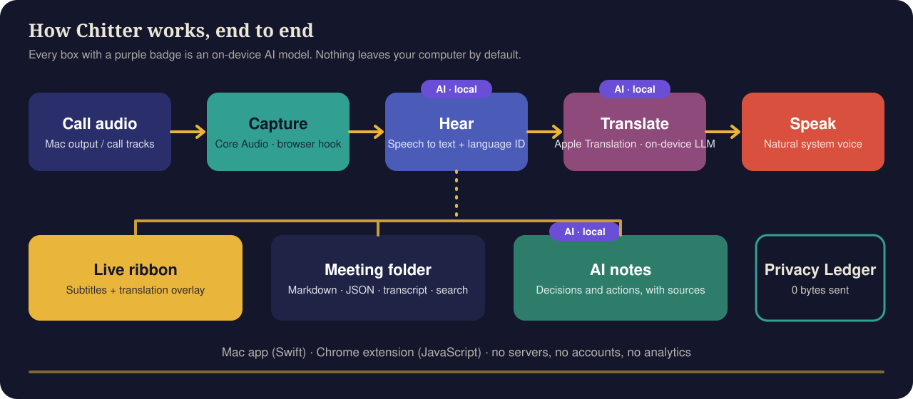

<div align="center">


# 📘 Chitter, explained

**A real-time speech-translation and meeting-intelligence system, built end to end as a software engineering project.**<br>
The simple explanation, the system design, the engineering stack, where AI is used, the numbers, the business case, and ready-to-use resume and interview material.

</div>

---

## 📑 Contents

1. [The project in 60 seconds](#1--the-project-in-60-seconds)
2. [Simple explanation (no jargon)](#2--simple-explanation-no-jargon)
3. [Real-world use cases](#3--real-world-use-cases)
4. [System design](#4--system-design)
5. [Engineering stack, by skill area](#5--engineering-stack-by-skill-area)
6. [Engineering concepts demonstrated](#6--engineering-concepts-demonstrated)
7. [Where AI is used, and which AI](#7--where-ai-is-used-and-which-ai)
8. [Numbers](#8--numbers)
9. [Achievements](#9--achievements)
10. [Business case](#10--business-case)
11. [Updates and timeline](#11--updates-and-timeline)
12. [STAR format for your resume and interviews](#12--star-format-for-your-resume-and-interviews)
13. [Honest status and limits](#13--honest-status-and-limits)
14. [Interview questions and honest answers](#14--interview-questions-and-honest-answers)
15. [Glossary](#15--glossary)
16. [Where to find things in the repo](#16--where-to-find-things-in-the-repo)

---

## 1. ⏱️ The project in 60 seconds

| | |
|---|---|
| **Name** | Chitter |
| **Tagline** | *Catch every word. Keep what matters.* |
| **What it is** | A system that makes calls understandable in real time: live subtitles, foreign speech spoken to you in your language, your own voice interpreted into the call, and meeting notes where every decision links to the exact line it came from |
| **Two clients** | 🍎 a native **desktop application** (macOS) and 🌐 a **browser extension** (Chrome, for Windows, Linux, ChromeOS and Mac), sharing one architecture |
| **Key engineering constraint** | **On-device processing.** No meeting bot, no server, no account. By default nothing about a meeting leaves the machine, and a built-in ledger proves it |
| **My role** | Software engineer: requirements, architecture, implementation, testing, performance measurement, packaging and documentation, end to end |
| **Scale** | ~5,000 lines of code across 5 languages, 9 backend-style modules, 61 automated checks |
| **Repo** | https://github.com/Ayush277/chitter |

---

## 2. 🧒 Simple explanation (no jargon)

Imagine you are on a video call and a colleague starts speaking Spanish, and you only speak English.

**Without Chitter:** you miss most of it, ask them to repeat, and afterwards nobody remembers exactly what was agreed.

**With Chitter:**
1. It **notices the call started** and wakes up by itself.
2. It **listens** to what comes out of your speakers.
3. It **works out which language** is being spoken.
4. It **writes down** the words and shows them as **subtitles**.
5. It **translates** them and **says them out loud in English**, in a natural voice.
6. When the call ends, it writes **notes**: a summary, decisions and action items.
7. Every note has a small tag like *(L7)* pointing to the **exact sentence** it came from, so you can check it instead of trusting a computer's word.

All of this happens **on your own computer**. A built-in "Privacy Ledger" window shows every network connection the app makes, and by default the answer is *"Nothing left your Mac."*

> **One-sentence version:** *Chitter is a private, on-device assistant that subtitles, translates and summarises calls, and proves where every note came from.*

---

## 3. 🌍 Real-world use cases

| 👤 Who | 😣 Problem today | ✅ How Chitter helps |
|---|---|---|
| **Cross-border teams** (for example India–Europe–US) | Meetings mix languages; non-native speakers miss details | Subtitles plus an English voice-over; the speaker can switch language mid-call |
| **Students** | Lectures and webinars in a second language | Live captions and a searchable transcript with notes afterwards |
| **Deaf and hard-of-hearing people** | Many calls and videos have no captions | Captions on **any** audio, with an accessibility mode (large, high-contrast text, 28 pt or more) |
| **Lawyers, doctors, journalists, researchers** | Cannot send sensitive conversations to a cloud service | Everything runs locally; the ledger proves it |
| **Language learners** | Hard to follow native-speed streams | Original text with translation underneath |
| **Anyone who forgets** | "What did we decide?" | Notes with decisions and owners, each linked to its source line |
| **Remote interviews and customer calls** | Taking notes while talking hurts the conversation | Notes write themselves; nobody has to accept a bot into the meeting |

---

## 4. 🏗️ System design

<div align="center"></div>

```text
🔊 call audio ─► capture ─► stream processing (VAD, resample) ─► speech-to-text + language ID
                                                                      │
                  🗨️ subtitles ◄── translate ◄───────────────────────┤
                  🔈 voice queue ◄─┘                                  └─► 📁 append-only transcript ─► 🧠 notes ─► 🔎 search / export
```

### The five stages
| # | Stage | Desktop app | Browser extension |
|---|---|---|---|
| 1 | **Capture** | OS audio *process tap* on the sound output | Hook on the page's WebRTC connection; one audio track per participant |
| 2 | **Stream processing** | Resample to 16 kHz mono, voice-activity detection, ring buffer | Track handed directly to the recogniser |
| 3 | **Recognise** | On-device speech model + language detection | Browser on-device speech + language detection |
| 4 | **Translate and render** | Translator chain → ribbon UI + voice queue | Translator → overlay + voice queue |
| 5 | **Persist and summarise** | Append-only JSONL, SQLite FTS index, notes provider chain | In-memory transcript, Markdown export, notes via browser model |

### Three design ideas worth explaining
1. **Auto-start without a bot (event detection).** The app asks the operating system which processes currently have the microphone open. A known call app or a browser with the mic open means *a call is happening*. A small **state machine with hysteresis** (a 12-second grace period) stops a brief mute from being treated as a hang-up.
2. **Low perceived latency (streaming + backpressure).** As the live transcript grows, each finished sentence is translated and queued **once**, before the speaker stops. The queue **adapts its rate** (up to about 1.3×) when it falls behind and then **drops the oldest item** rather than letting delay grow without bound.
3. **Verifiable AI output (validation layer).** The notes model must return structured JSON citing transcript line IDs. A validator **rejects any item that cites a line that doesn't exist**, so the model cannot invent its sources, and a UI draws each note to its source line.

Full diagrams and module breakdown: [`docs/ARCHITECTURE.md`](docs/ARCHITECTURE.md)

---

## 5. 🧰 Engineering stack, by skill area

| 🎯 Skill area | 🔧 What I used | 📍 Where / what for |
|---|---|---|
| **Languages** | **Swift**, **JavaScript**, **Python**, **Shell (bash)**, **SQL**, **HTML/CSS** | App and logic (Swift, JS), tooling and fixtures (Python, bash), search queries (SQL), web (HTML/CSS) |
| **System design** | Modular architecture (9 modules with one-way dependencies), pipeline architecture, plug-in style provider interfaces | `Sources/` (EchoCore, EchoAudio, EchoASR, EchoLang, EchoNotes, EchoVoice, EchoNet, EchoUI, EchoApp) |
| **Design patterns** | Strategy and fallback chain, Adapter, Facade, Observer / pub-sub, Producer-consumer queue, State machine | ASR engine interface, translator and notes chains, the network gateway, ledger updates, the voice queue, the call watcher |
| **Concurrency and streaming** | `async/await`, actors, structured tasks, locks, ring buffers, real-time audio callbacks | Audio capture threads, the voice queue, the translator chain with cool-downs and caching |
| **OS and device APIs** | Core Audio (process taps, per-process state), AVFoundation, Keychain, global hotkeys | Capturing audio, detecting calls, speech output, storing secrets |
| **Web platform** | WebRTC, Web Audio / MediaStream, Shadow DOM, Chrome Extension **Manifest V3**, Chrome built-in AI APIs | The browser client: hooking calls, overlay UI, on-device models |
| **Data and storage** | **SQLite FTS5**, append-only **JSONL** logs, plain-file storage, idempotent writes | Crash-safe transcripts, misspelling-tolerant search, Markdown/JSON/SRT/DOCX export |
| **AI/ML integration** | On-device speech, translation and language models behind interfaces, prompt design, output validation | See [section 7](#7--where-ai-is-used-and-which-ai) |
| **API integration** | OpenAI-compatible HTTP client, retry with exponential back-off, rate-limit handling | Optional cloud providers behind one gateway |
| **Security and privacy engineering** | Keychain storage, checksum pinning (SHA-256), least-privilege permissions, a single audited network gateway, Trusted Types compliance, file permissions `0700/0600`, message allow-listing | Throughout; enforced by tests |
| **Testing and quality** | Unit tests, stubbed network layer, fixtures, in-browser tests, a WebRTC loopback smoke test, source-scanning "rule" tests, accessibility contrast tests, benchmarks, 30-minute soak test | `Tests/`, `extension/test/`, `scripts/bench.sh` |
| **Performance engineering** | Profiling stages, model warm-up, prefetching, backpressure | Cut warm translation from 2.8–3.6 s to 1.4–2.0 s |
| **Build and delivery** | SwiftPM builds, shell packaging (DMG, ZIP, checksums), Homebrew cask template, CI workflow definitions, reproducible build script | `scripts/`, `docs/github-workflows/` |
| **Front end and UX** | SwiftUI, AppKit, accessible design (VoiceOver labels, keyboard use, reduced motion, WCAG contrast), localisation scaffold (5 languages) | Desktop UI, extension overlay, website |
| **Documentation** | Architecture docs, decision log (18 entries), per-phase test log | `docs/`, `DECISIONS.md` |
| **Third-party code** | **WhisperKit** (speech recognition library) | `EchoASR` |

More detail: [`docs/TECH_STACK.md`](docs/TECH_STACK.md)

---

## 6. 🧠 Engineering concepts demonstrated

| Concept | How it shows up in this project |
|---|---|
| **Separation of concerns** | Nine modules; only one (`EchoNet`) may touch the network, enforced by a test |
| **Dependency inversion** | Speech, translation and notes sit behind interfaces, so engines can be swapped (Apple, Whisper, local server, cloud) |
| **Fault tolerance and graceful degradation** | Every AI step has a fallback chain ending in plain code; failing providers are put on a cool-down; the app never ends with "nothing" |
| **Resilience of data** | Append-only logs survive a crash mid-write; a torn last line is skipped, not fatal |
| **Real-time systems** | Fixed-rate audio callbacks, buffers, voice-activity detection, bounded queues |
| **Backpressure and load shedding** | The voice queue speeds up, then drops the oldest line instead of growing delay |
| **State machines** | Call detection with hysteresis |
| **Caching and warm-up** | Translation cache; model warm-up when a call starts (first call 6 s → later 1.4–2.0 s) |
| **Observability** | The Privacy Ledger records every request; headless test modes print stage timings |
| **Security by construction** | A single network gateway, least-privilege extension permissions, checksum-verified installer, input allow-lists |
| **Testing strategy** | Unit, integration-style (loopback WebRTC), static "rule" tests, benchmarks and soak tests |
| **Measure, then optimise** | Timed each stage before changing anything; reported targets that were **not** met |
| **Cross-platform thinking** | Same architecture in Swift and JavaScript; shared design, separate capture layers |
| **Accessibility as a requirement** | Contrast test, large-text mode, keyboard operation |

---

## 7. 🤖 Where AI is used, and which AI

> **Rule of the project:** AI runs **on the device** by default. Cloud AI is optional, off, and needs your own key.

### 7.1 The AI map

| 🧠 Job | 🍎 Desktop app | 🌐 Browser extension | 📍 Runs |
|---|---|---|---|
| **Speech to text** | **Apple SpeechAnalyzer** (macOS 26+) or **OpenAI Whisper** via WhisperKit | Chrome built-in `SpeechRecognition` (`processLocally`) | On your device |
| **Language detection** | **Whisper** per utterance; **NaturalLanguage** text check; a safeguard re-checks implausible results (Spanish heard as Latin) | Chrome `LanguageDetector` + a confidence probe that tries candidate languages | On your device |
| **Translation** | **Apple Translation** packs, then **Apple's on-device language model** as a no-download fallback | Chrome `Translator` | On your device |
| **Notes** | **Apple on-device language model** → **Ollama** (local) → your own API key (Gemini, Groq, OpenRouter, custom) → offline rule-based extractor | Chrome `LanguageModel` (Gemini Nano) → offline rule-based extractor | On your device by default |
| **Voice** | OS speech synthesis, choosing the best installed voice (Premium → Enhanced → standard) | Browser `speechSynthesis`, preferring natural local voices | On your device |

### 7.2 Where AI is **not** used (on purpose)
Audio capture, call detection, voice-activity detection, search, storage, export, the Privacy Ledger, the interface and every safety check are **ordinary, testable code**. The notes also have a **non-AI fallback**, so the app still produces notes with no model installed.

### 7.3 Engineering around AI (making it reliable)
| Risk | Engineering defence |
|---|---|
| Model returns malformed output | Require JSON, validate, retry once with a repair prompt, then fall back |
| Model invents sources | Validator drops items citing non-existent line IDs |
| Model or service unavailable | Provider chains ending in deterministic code |
| Free tiers rate-limit | Exponential back-off, then the next provider; cool-downs and a cache |
| Long meetings overflow a model | Map-reduce: summarise chunks, merge, keep line IDs |
| High first-call latency | Warm the model at call start |
| Sensitive data | Cloud is opt-in; only **text** (never audio) is sent; every request is logged in the ledger |

### 7.4 AI results measured in this project
| Test | Result |
|---|---|
| Speech accuracy, 11.5 s English clip | **2.6%** word error rate (Apple and Whisper base) |
| Notes from a sample meeting (on-device model, no API key) | Every decision and action cited a real transcript line (valid-reference share 1.0) |
| Foreign speech → English voice, warm model, 6–8 s clips | **Chinese, Japanese, French, Spanish** each detected, translated and voiced in **3.8–6.2 s** |
| Translation with the on-device model | **1.4–2.0 s** per sentence once warm; **~6 s** on the first call while the model loads |
| Language detection, 5 test languages | 4 of 5 at first (Spanish misread as Latin), then fixed by the safeguard |

---

## 8. 🔢 Numbers

### 8.1 Size of the project (counted from the repo)
| Metric | Value |
|---|---|
| Application code | **4,564 lines** in **50 files**, **9 modules** |
| Automated Swift tests | **505 lines**, **58 tests** |
| Browser extension (code + tests) | **797 lines** of JavaScript, **16 browser checks** + a WebRTC smoke test |
| Website | **274 lines** (HTML, CSS, JS), about **25 KB**, no framework |
| Documentation | **739+ lines** of Markdown |
| Interface strings | **97** in a localisation catalog (English complete; 4 more languages scaffolded for review) |
| Scripts | **10** (build, test, package, benchmark, fixtures, release) |
| Languages used | **5** (Swift, JavaScript, Python, Shell, SQL) plus HTML/CSS |
| Commits | **21** |
| Logged design decisions | **22** in `DECISIONS.md` |

Lines per module: `EchoUI` 1,240 · `EchoApp` 1,100 · `EchoCore` 606 · `EchoAudio` 388 · `EchoVoice` 334 · `EchoASR` 283 · `EchoNotes` 281 · `EchoNet` 191 · `EchoLang` 141.

### 8.2 Performance (one Mac: Apple silicon, macOS 27.0.1)
| Metric | Result | Note |
|---|---|---|
| App size | **9.8 MB** | AI models download on demand |
| Cold start | **0.07 s** | launch to ready, then exit |
| Soak test | **30 minutes, 584 sentences, no crash** | looped test audio |
| Process CPU during soak | **0.9% average** | the app's own process only |
| Process memory during soak | **8–23 MB** | excludes the OS's separate speech process |
| First subtitle | **2.0 s** (Whisper), **4.1 s** (Apple engine) | target of 1.5 s **not met** |
| Voice-over end to end (warm) | **3.8–6.2 s** | per 6–8 s clip |

> ⚠️ CPU and memory cover the application's own process only; the OS's speech recogniser runs separately and isn't included, so real total load is higher.

### 8.3 Cost and privacy
| | |
|---|---|
| Cost to run (default setup) | **$0.00** per meeting hour |
| Meeting data sent off the device (default) | **0 bytes** |
| Accounts, analytics, servers | **None** |
| Third-party libraries in the app | **1** |
| Browser extension permissions | **4** (`storage`, `scripting`, `tabCapture`, `activeTab`) |
| Live audio → translated subtitle (2026-11-27) | translation **2.0–3.4 s** after each recognised line (German, Chinese, French) |

---

## 9. 🏆 Achievements

**Engineering**
- Designed and built a **two-client system** (desktop app and browser extension) from one architecture, plus a website, packaging scripts and demo videos.
- Reached **measured results on real audio**: 2.6% word error rate, a 30-minute soak test with no crash, and four languages translated to a spoken English voice.
- Wrote **58 unit tests and 16 browser checks**, including tests that enforce *design rules*: "no code outside one module may use the network" and "no extension file may make a network request".
- **Diagnosed and fixed a production-style failure**: the extension crashed on Google Meet because Meet enforces a security policy (Trusted Types). I reproduced it in a test with the same policy, fixed it, and added a regression test.
- **Cut latency with measurement**: profiled the translation stage, found a ~6 s first-call cost, and added warm-up, early speaking and prefetching.
- Replaced flaky retries with a **root-cause fix** for an unreliable test-plugin problem on a minimal toolchain.

**Product and design**
- **Auto-start on calls** in native apps and browser tabs with no extra extension or permission.
- **Pull the Thread**: an interface that draws a line from each AI note to its source sentence, making AI output checkable.
- A **Privacy Ledger** that turns "private" into something a user can verify.
- Accessibility mode, a **contrast test** that caught and fixed two failing colours, and a localisation scaffold.

**Process**
- Every test result, including failures, is logged in `docs/PROGRESS.md`; every judgement call in `DECISIONS.md`.
- Targets that were **not met** are stated in the README instead of hidden.

---

## 10. 💼 Business case

*Reasoning and ideas, not measured results.*

### 10.1 The gap
Most meeting-AI products are **cloud-based**, **bot-based** or **paid**. A free, local-first, source-linked alternative has a clear position. Other open-source meeting tools exist, so differentiation matters.

### 10.2 Differentiators
| Differentiator | Why it matters |
|---|---|
| **No bot**, works with any call app | Nobody has to be invited or asked to accept a bot |
| **On-device by default** | Privacy, no running cost, works offline, usable in regulated settings |
| **Notes with sources (Pull the Thread)** | Users verify AI output instead of trusting it |
| **Voice-over of foreign speech** | Goes beyond captions to real-time understanding |
| **Desktop app plus browser extension** | Reaches Windows and Linux users in the browser |
| **Accessibility built in** | Large high-contrast captions, screen-reader labels, keyboard use |
| **Open formats** | Plain Markdown, JSON and audio files that open in Obsidian |

### 10.3 Who would pay (possible)
- **Teams in regulated industries** (legal, healthcare, finance, government) that cannot use cloud transcription.
- **Companies with multilingual teams** wanting a managed, auditable rollout.
- **Education and accessibility programmes** needing captions on any audio.

### 10.4 Possible business models
| Model | How it works |
|---|---|
| **Open core** | Free app; paid **team features**: managed deployment, shared glossaries, admin controls |
| **On-premise and enterprise support** | Installation, audits, compliance documentation, support contracts |
| **Premium voices and models** | Optional bring-your-own-key or paid natural voices and larger models |
| **Education and accessibility plans** | Discounted plans for schools and non-profits |

### 10.5 Go-to-market ideas
Open source on GitHub, Homebrew, a Chrome Web Store listing, demo videos, and posts in accessibility, language-learning and privacy communities.

### 10.6 Risks (be honest about these)
- **Recording-consent laws** vary; users must tell participants they are transcribing.
- **Platform dependence** on Apple's and Chrome's on-device models and permissions, which can change.
- **Quality** for less common languages and noisy audio.
- **Real-call verification** still to be completed (section 13).
- **Distribution** without a paid developer account means an un-notarised Mac app and a manual first-launch step.

---

## 11. 🕒 Updates and timeline

| Date | Update |
|---|---|
| 2026-11-24 | **Foundation.** 9-module project, menu-bar app, build and packaging scripts, test setup |
| 2026-11-24 | **Hearing.** System-audio capture, two speech engines, the subtitle ribbon. Measured 2.6% word error rate |
| 2026-11-24 | **Languages.** Language detection (4 of 5 languages at first), translation provider chain |
| 2026-11-24 | **Records.** Meeting storage, misspelling-tolerant search, export to Markdown/SRT/Word, Keychain, the single network gateway |
| 2026-11-24 | **Notes.** Provider chain with offline fallback, source-line validation, *Pull the Thread* interface |
| 2026-11-24 | **Interpreting.** Hold-to-talk voice into a virtual microphone; checksum-pinned installer |
| 2026-11-24 | **Polish.** Settings, Privacy Ledger window, onboarding, accessibility mode, localisation scaffold, contrast tests |
| 2026-11-24 | **Website, packaging, benchmark.** 25 KB site, DMG/ZIP builds, 30-minute soak test; v0.1.0 tagged |
| 2026-11-24 | **Auto-start and voice-over.** Call detection in apps and browsers; foreign speech translated and spoken; per-sentence language detection with a Spanish/Latin safeguard |
| 2026-11-25 | **Performance.** Model warm-up (first call 6 s → later 1.4–2.0 s), early sentence speaking, voice prefetch |
| 2026-11-25 | **Browser extension.** On-device subtitles, voice-over and notes for Windows, Linux, ChromeOS and Mac |
| 2026-11-25 | **First real-use bug fixed.** Extension crashed on Google Meet (Trusted Types); reproduced in a test, fixed, regression-tested. Added "caption my own voice" |
| 2026-11-25 | **Videos, documentation and public release** on GitHub |
| 2026-11-27 | **Live capture fixed.** A mistyped Core Audio key meant the desktop app had received no audio; after the fix, live subtitles and notes worked on audio played on the Mac |
| 2026-11-27 | **Meeting features.** Hands-free interpreting, interpreted lines in the transcript, display modes, live panel, voice and mic pickers, word list, notes language; extension rebuilt around one recogniser plus tab capture |

**Next:** verify real-call capture on more machines, faster voice-over with installed translation packs, a Chrome Web Store release and a Windows client. See [`docs/ROADMAP.md`](docs/ROADMAP.md).

---

## 12. ⭐ STAR format for your resume and interviews

> Use only what you can explain in your own words. Every claim below is backed by a measurement or test in this repo.

### 12.1 Main STAR story

| | |
|---|---|
| **S: Situation** | Calls mix languages, many have no captions, and the AI tools that fix this usually put a bot in the meeting or send private conversations to the cloud |
| **T: Task** | Design and build a system that gives live subtitles, spoken translation and trustworthy notes **entirely on the user's device**, for desktop and for browsers on other operating systems |
| **A: Action** | Designed a modular architecture (9 modules, one-way dependencies) around a streaming pipeline: capture → recognise → translate → speak → persist. Put each AI capability behind an interface and built **fallback chains** (strategy pattern) so a missing model or service degrades gracefully. Added a **validation layer** that rejects AI notes citing non-existent sources. Enforced privacy through a **single network gateway**, a user-visible ledger and a test that fails the build if other code touches the network. Handled real-time constraints with bounded queues, backpressure and prefetching. Wrote 58 unit tests and 16 browser checks, benchmarked accuracy and latency, and ran a 30-minute soak test |
| **R: Result** | 2.6% word error rate; four languages detected, translated and spoken in English in 3.8–6.2 s; 30-minute soak with no crash; 9.8 MB app; $0 running cost and 0 bytes of meeting data sent by default; shipped as a documented public repository with a website and demo videos |

### 12.2 Smaller STAR stories

**The silent audio bug**
- **S:** The desktop app showed no subtitles on live audio, although every unit test passed and I had assumed a missing OS permission.
- **T:** Find out why capture returned nothing.
- **A:** Added a headless capture test that reports seconds captured and peak level, ran it as the app itself so the permission applied, got 0 samples, then checked each setting against the SDK header. The tap list used the key `"uuid"`; the real key is `"uid"`, and the OS silently ignored the wrong one. Switched to the SDK constants and added a regression test.
- **R:** From 0 s to 14.5 s of audio captured; German, Chinese and French then flowed through to translated subtitles. **Lesson:** test the real device path early, and check an assumed cause before accepting it.

**Debugging a real-world failure**
- **S:** The browser extension passed all tests but did nothing on a real Google Meet call.
- **T:** Find the root cause.
- **A:** Hypothesised that Meet's Trusted Types policy blocks HTML assignment from strings, reproduced the crash by adding that policy to a test page, rebuilt the overlay with safe DOM APIs, isolated overlay failures from the call hook, and added a regression test forbidding the pattern.
- **R:** Failure reproduced, then passed under the same policy; the test prevents it from returning.

**Performance optimisation**
- **S:** Voice-over translation took 2.8–3.6 s per sentence.
- **T:** Make it feel closer to live.
- **A:** Measured each stage and found a ~6 s first-call cost versus 1.1–1.6 s afterwards. Warmed the model at call start, fixed sampling to be deterministic, spoke each finished sentence before the utterance ended, and prefetched the next audio clip while one played.
- **R:** Warm translation fell to 1.4–2.0 s and the whole path to 3.8–6.2 s on four test clips.

**Quality and accessibility**
- **S:** The colour palette looked fine but readability was untested.
- **T:** Meet the WCAG AA contrast ratio (4.5:1) for body text.
- **A:** Wrote an automated test over every text-and-background pair.
- **R:** It caught two failures (4.47:1 on dark and 2.9:1 on light); I adjusted one colour and added a darker variant for light surfaces, and the test now passes.

**Designing for failure**
- **S:** AI models and free API tiers can be missing, slow or rate-limited.
- **T:** Make sure the product never ends up with no result.
- **A:** Built ordered provider chains with cool-downs, a cache, exponential back-off and a deterministic last resort; unit-tested the fall-through behaviour with mock providers.
- **R:** Tests show a failing or unavailable provider is skipped and the chain still produces notes.

### 12.3 Resume

**Project line**
> **Chitter**: real-time, on-device speech translation and meeting-notes system (desktop app + browser extension) | Swift, JavaScript, Python, SQL, Shell, Core Audio, WebRTC, SQLite, on-device ML | [github.com/Ayush277/chitter](https://github.com/Ayush277/chitter)

**Bullets** *(pick 3–5)*
- Designed and built a **two-client, on-device system** (desktop app and Manifest V3 browser extension, ~5k lines, 9 modules) that delivers live subtitles, spoken translation and AI meeting notes with **$0 running cost** and **0 bytes** of meeting data sent by default.
- Engineered a **streaming pipeline** (capture → speech recognition → translation → speech output) with bounded queues, backpressure and prefetching; cut warm translation latency from 2.8–3.6 s to **1.4–2.0 s** and end-to-end voice-over to **3.8–6.2 s** across four languages.
- Applied **fault-tolerant design**: strategy-pattern provider chains with cool-downs, caching and exponential back-off so every AI step degrades to deterministic code when a model or service is unavailable.
- Built a **validation layer for AI output**: notes must cite transcript line IDs and the system rejects invalid citations, plus a UI that draws each note to its source.
- Enforced **security and privacy by construction**: a single audited network gateway, a user-visible request ledger, Keychain storage, checksum-pinned installer and least-privilege permissions, backed by tests that fail the build on violations.
- Verified quality with **58 unit tests, 16 browser checks, a WebRTC loopback test and a 30-minute soak test** (584 sentences, no crash); recorded 2.6% word error rate and documented the targets not yet met.
- Root-caused and fixed a **production-style failure** (browser security policy blocking the extension on Google Meet) by reproducing it in a test and adding a regression guard.

**Skills line**
> **Languages:** Swift, JavaScript, Python, SQL, Bash, HTML/CSS · **Concepts:** system design, concurrency and streaming, design patterns, fault tolerance, API integration, testing, performance profiling, security and privacy engineering · **Tools:** Core Audio, WebRTC, SQLite (FTS5), Chrome Extensions (MV3), SwiftPM, Git, on-device ML (Whisper, Apple Intelligence, Chrome built-in AI)

**One-line version**
> Built an on-device, privacy-first system (desktop app + browser extension) that subtitles, translates, speaks and summarises calls in real time, with AI notes you can verify, at $0 running cost.

### 12.4 LinkedIn "About" paragraph
> I'm a software engineer who built Chitter, an open-source assistant for calls. It listens to your computer's audio, shows live subtitles, speaks foreign languages aloud in yours, and writes meeting notes where every decision links to the exact sentence it came from. Everything runs on your own device, so nothing about your meetings goes to a cloud service. I designed the architecture (a streaming pipeline with fallback chains and a single audited network gateway), implemented a desktop app and a browser extension, and measured accuracy, latency and stability. I care about privacy, accessibility and making AI output checkable instead of trusted.

---

## 13. ⚠️ Honest status and limits

> **Say this clearly in interviews.** It shows engineering maturity, and the repo already states it.

| Area | Status |
|---|---|
| Speech, language ID, translation, notes and voice on real test audio | ✅ **Run for real** with measured results |
| Search, storage, export, call-detection logic, queueing, notes validation, checksum, contrast | ✅ **Unit-tested** |
| Browser extension logic and a WebRTC loopback call (with Meet's security policy) | ✅ **Tested** (16 checks + smoke test) |
| Live **system audio** through the whole desktop app (speech played on the Mac) | ✅ **Verified** 2026-11-27 |
| A **real call** with another person on the desktop app | ⚠️ **Not yet verified** |
| Auto-start during a **real call** | ⚠️ Detection ran against the live system and is unit-tested; **not seen in a real call** |
| Browser extension **loaded in a real browser** (call audio, tab capture, model download) | ⚠️ **Not yet verified** |
| Microphone → virtual-microphone interpreter (hold-to-talk and hands-free) | ⚠️ **Built, not run with a real microphone** |
| New settings screens and live panel | ✅ Rendered from the app and checked |
| Targets: first subtitle 1.5 s; interpreter 4 s | ❌ **Not met** (measured 2.0–4.1 s and 3.8–6.2 s) |

**Other limits**
- Voice-over plays on **your** speakers only; other participants do not hear it.
- The extension cannot speak *into* a call (browsers offer no API for it), so "interpret my voice" is desktop-only.
- The small Whisper model is imperfect on Spanish and Japanese; larger models are more accurate but slower.
- Apple's on-device translation and notes models need **macOS 26 with Apple Intelligence**; the extension needs **Chrome 139+**.
- The desktop app is **not notarised**, so first launch needs a right-click → Open.
- Recording-consent laws apply: tell people you are transcribing.

---

## 14. 🎤 Interview questions and honest answers

**"Walk me through the architecture."**
A streaming pipeline: capture audio, process it (resample, detect speech), recognise and detect language, translate, then render subtitles and queue speech, while persisting an append-only transcript that feeds a notes generator. Nine modules with one-way dependencies; the speech, translation and notes capabilities sit behind interfaces so implementations can be swapped.

**"What design patterns did you use and why?"**
Strategy with a fallback chain for AI providers (any one can be missing), Adapter for the speech engines, a Facade for the network gateway (so privacy can be enforced in one place), Observer for live ledger updates, a producer-consumer queue for voice output, and a state machine with hysteresis for call detection.

**"How do you handle concurrency?"**
Audio arrives on real-time callback threads, so those only copy samples into buffers. Everything else uses async/await, actors for shared state (the network gateway, the voice queue, the translator chain), and locks where a callback must stay synchronous. The voice queue is bounded, so a slow consumer cannot grow memory or delay without limit.

**"How do you test something this dependent on hardware and AI?"**
I separate pure logic from device code. Logic (call classification, queueing, validation, search, export) has unit tests with stubs and mock providers. For hardware and models I built headless modes that run the real components on recorded fixtures and print timings. For the browser I wrote an in-browser test suite and a loopback WebRTC call. And I wrote "rule" tests that scan source for forbidden patterns, such as network access outside the gateway.

**"What was the hardest bug?"**
The extension passed every test but did nothing on Google Meet. Meet enforces Trusted Types, which forbids setting HTML from a string, and my overlay did that at startup, so the script died before hooking the call. I reproduced it by adding the same policy to a test page, rebuilt the overlay with safe DOM APIs, isolated overlay failures from the call hook, and added a regression test.

**"How did you reduce latency?"**
I measured each stage first: the translation model's first call cost about 6 s (loading), later calls about 1.1–1.6 s. So I warm it when a call starts, make decoding deterministic, speak each finished sentence before the speaker stops, and prefetch the next audio clip while the current one plays.

**"How do you make AI output trustworthy?"**
I don't trust it by default. Notes must be JSON citing transcript line IDs; a validator drops anything citing a line that doesn't exist; there is a retry with a repair prompt and a deterministic fallback; and the UI shows each note's source so a person can verify it.

**"How does it fail?"**
Gracefully. A missing model or rate-limited provider is skipped and put on a cool-down; if every AI option fails, a rule-based extractor still produces notes. A crash mid-write loses at most one partial line because transcripts are append-only.

**"What didn't work?"**
The 1.5 s first-subtitle target was missed (2.0 s with Whisper, 4.1 s with Apple's engine, which delivers results in bursts). Language detection misheard Spanish as Latin; I added a safeguard that re-checks likely languages. My biggest miss: the desktop app captured no audio at first because of one mistyped OS key, and I blamed permissions until I tested the device path directly. A real call with another person is still unverified.

**"How would you scale it or take it cross-platform?"**
The capture layer is the only platform-specific part. I already built a browser version that covers Windows and Linux for web calls. A Windows client would need loopback audio capture and a Windows speech stack, reusing the notes logic, validation rules and file format.

**"How would you make money from it?"**
Keep the app free and open source; sell managed team deployment, on-premise installs and support to regulated industries, plus education and accessibility plans. These are ideas, not validated.

**"What would you do next?"**
Verify real-call capture on more machines, ship the extension through the Chrome Web Store, speed up voice-over with installed translation packs, and build a Windows client.

---

## 15. 📖 Glossary

| Term | Meaning |
|---|---|
| **On-device AI** | AI that runs on your own computer instead of a remote server |
| **ASR / speech recognition** | Turning speech audio into text |
| **Whisper / WhisperKit** | A multilingual speech-recognition model, and a Swift library that runs it |
| **Language model (LLM)** | An AI model that reads and writes text; used here for translation and notes |
| **Process tap** | An OS feature that lets an app listen to other programs' audio output |
| **WebRTC** | The browser technology behind video calls |
| **Manifest V3** | The current format for Chrome extensions |
| **Trusted Types** | A browser security policy that blocks unsafe HTML injection |
| **Provider chain** | An ordered list of options tried until one works (strategy + fallback) |
| **Backpressure** | Slowing down or shedding work when a consumer cannot keep up |
| **Hysteresis** | Requiring a condition to persist before changing state, to avoid flapping |
| **Append-only log** | A file that is only ever added to, so a crash cannot corrupt earlier data |
| **FTS5** | SQLite's full-text search feature |
| **WER (word error rate)** | Percent of words transcribed wrongly; lower is better |
| **Soak test** | Running a system for a long time to check it stays stable |
| **Privacy Ledger** | The window listing every network request the app made |
| **Pull the Thread** | The interface that draws a line from a note to its source sentence |
| **WCAG AA** | An accessibility standard; body text needs a 4.5:1 contrast ratio |

---

## 16. 🗂️ Where to find things in the repo

| I want to see… | Go to |
|---|---|
| The pitch and install steps | [`README.md`](README.md) |
| Diagrams and design | [`docs/ARCHITECTURE.md`](docs/ARCHITECTURE.md) |
| Every technology | [`docs/TECH_STACK.md`](docs/TECH_STACK.md) |
| The idea and business reasoning | [`docs/PROJECT_OVERVIEW.md`](docs/PROJECT_OVERVIEW.md) |
| What stays private | [`docs/PRIVACY.md`](docs/PRIVACY.md) |
| Every check result, including failures | [`docs/PROGRESS.md`](docs/PROGRESS.md) |
| Every judgement call | [`DECISIONS.md`](DECISIONS.md) |
| Benchmark data | `docs/bench-results.json` |
| What's next | [`docs/ROADMAP.md`](docs/ROADMAP.md) |
| The desktop app code | `Sources/` |
| The browser extension | `extension/` |
| The website and videos | `site/` |
| Run the tests | `scripts/test.sh` (unit) · `extension/test/test.html` (browser) |

<div align="center"><sub>Chitter · by <a href="https://github.com/Ayush277">Ayush Kumar</a></sub></div>
