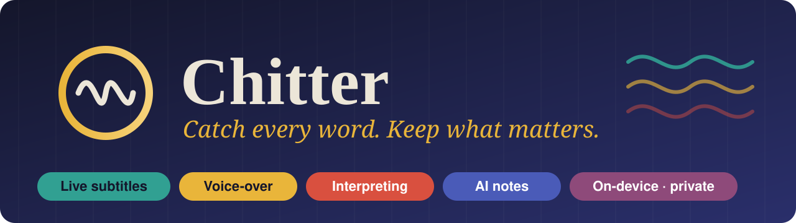
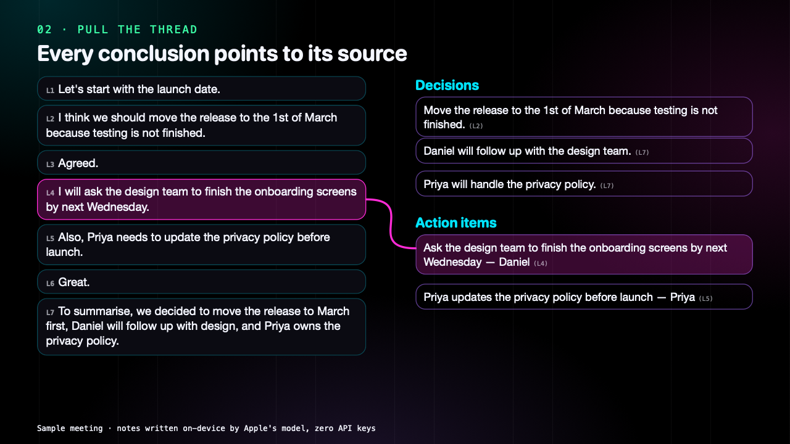
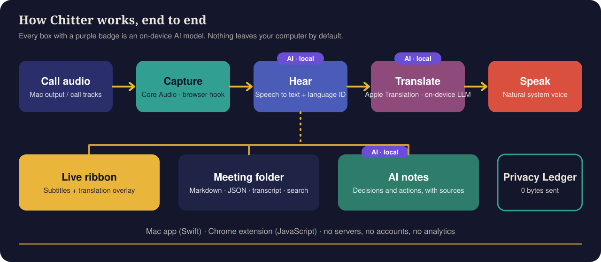

<div align="center">



<br>


**A real-time speech-translation and meeting-notes system, built as a software engineering project:  live subtitles, an English voice-over of foreign speech,<br>your own voice interpreted into the meeting, and notes that show where every decision came from.**

*No bot joins your meeting. By default, nothing about your meetings leaves your computer.*

</div>

---

## 🎬 See it

<div align="center">

[](site/media/showcase.mp4)

**▶ [Watch the showcase](site/media/showcase.mp4)** (38 s, music only, no voice) · **▶ [Narrated explainer](site/media/explainer.mp4)** (73 s, synthesized voice)

</div>

> [!NOTE]
> Both videos are **animated illustrations** built from the app's real output (the transcript lines and notes shown are real results from a sample run). They are not screen recordings. Translation text shown in the subtitle example is illustrative.

---

## ✨ What it does

<table>
<tr>
<td width="64"></td>
<td><b>Starts by itself</b><br>Notices when a call begins (Zoom, Teams, FaceTime, Slack, Discord, or Meet/Teams in any browser) and pops up. Ends and writes the notes when the call ends.</td>
</tr>
<tr>
<td></td>
<td><b>Live subtitles</b><br>A slim ribbon over any call or stream, with the original and a translation. Language is detected for every sentence, so a call can switch languages mid-way.</td>
</tr>
<tr>
<td></td>
<td><b>Voice-over</b><br>Foreign speech is translated and <i>spoken aloud</i> in your language through the best installed system voice. It speaks each finished sentence early and speeds up slightly instead of falling behind.</td>
</tr>
<tr>
<td></td>
<td><b>Interpret my voice</b> <sub>(Mac app)</sub><br>Hold right ⌥, speak your language, and the translation is spoken into the call through a virtual microphone.</td>
</tr>
<tr>
<td></td>
<td><b>Notes you can check</b><br>Summary, decisions and action items written by an on-device AI model. Every item links to the exact transcript line it came from.</td>
</tr>
<tr>
<td></td>
<td><b>Pull the Thread</b><br>Hover or focus a note and an animated thread is drawn to its source line, so you can verify the AI instead of trusting it.</td>
</tr>
<tr>
<td></td>
<td><b>Your setup</b> <sub>(Mac app)</sub><br>Live transcript panel (⌃⌥L), show both languages or just one, a word list for names and jargon, notes in your language or the meeting's, hands-free interpreting, and a choice of voice (including your own macOS Personal Voice) and microphone.</td>
</tr>
<tr>
<td></td>
<td><b>Privacy Ledger</b><br>A window listing every network request the app makes. Default result: <i>"Nothing left your Mac in this meeting."</i></td>
</tr>
</table>

---

## 🧭 How it works

<div align="center"></div>

1. **Capture**: the Mac app taps the sound your Mac plays (Core Audio), so it works with any browser or call app. The Chrome extension merges the call's WebRTC audio into one stream, or captures the whole tab.
2. **Hear**: on-device speech recognition turns audio into text and detects the language.
3. **Translate**: Apple's translation, or Apple's on-device language model, translates it.
4. **Speak and show**: the subtitle ribbon updates and a natural system voice reads the translation.
5. **Remember**: the transcript is saved as plain files and an on-device model writes notes whose items cite transcript lines.

Details: [`docs/ARCHITECTURE.md`](docs/ARCHITECTURE.md)

---

## 🧰 Engineering stack at a glance

| 🎯 Skill area | 🔧 Used | 📍 Where |
|---|---|---|
| **Languages** | Swift · JavaScript · Python · Shell · SQL · HTML/CSS | App and logic, extension, tooling, search, web |
| **System design** | 9 modules with one-way dependencies; streaming pipeline | `Sources/` |
| **Design patterns** | Strategy + fallback chains · Adapter · Facade · Observer · Producer-consumer queue · State machine | Speech/translation/notes providers, network gateway, voice queue, call detection |
| **Concurrency** | async/await · actors · locks · real-time audio callbacks · bounded queues with backpressure | Capture, voice queue, translator chain |
| **OS and device APIs** | Core Audio (process taps, per-process state) · AVFoundation · Keychain · global hotkeys | Capturing audio, detecting calls, storing secrets |
| **Web platform** | WebRTC hook · Web Audio / MediaStream · Shadow DOM · Chrome Manifest V3 · Chrome built-in AI | `extension/` (Windows, Linux, ChromeOS, Mac) |
| **Data** | SQLite FTS5 · append-only JSONL logs · plain-file storage | Crash-safe transcripts, misspelling-tolerant search, export |
| **AI integration** | On-device speech, translation and language models behind interfaces · output validation | See below |
| **Security and privacy** | Single audited network gateway · Keychain · SHA-256 pinning · least-privilege permissions · Trusted Types compliance | Enforced by tests |
| **Testing** | 58 unit tests · 16 browser checks · WebRTC loopback test · rule tests · benchmarks · 30-minute soak | `Tests/`, `extension/test/`, `scripts/` |
| **Delivery** | Shell packaging (DMG, ZIP, checksums) · Homebrew cask template · CI workflow definitions | `scripts/`, `docs/github-workflows/` |
| **Front end and UX** | SwiftUI · AppKit · accessibility (contrast, keyboard, screen-reader labels) · localisation scaffold | Desktop UI, overlay, website |
| **Third-party code** | WhisperKit (speech recognition library) | `EchoASR` |

Full table with reasons: [`docs/TECH_STACK.md`](docs/TECH_STACK.md) · Skills, resume and interview material: [`PROJECT_EXPLAINED.md`](PROJECT_EXPLAINED.md)

---

## 🤖 Where AI is used

&nbsp; Every model below runs **on your device** by default. Cloud providers are optional, off, and bring-your-own-key.

| 🧠 Job | 🍎 Mac app | 🌐 Chrome extension |
|---|---|---|
| **Speech to text** | Apple SpeechAnalyzer, or **Whisper** (WhisperKit) | Chrome on-device `SpeechRecognition` |
| **Which language?** | Whisper per-utterance detection + text check | `LanguageDetector` |
| **Translation** | Apple Translation, or Apple's on-device **language model** | Chrome `Translator` |
| **Notes (summary, decisions, actions)** | Apple on-device **language model** → Ollama → your own API key → offline rules | Chrome `LanguageModel` (Gemini Nano) → offline rules |
| **Voice** | macOS speech synthesis | Browser `speechSynthesis` |

**Making the AI trustworthy:** notes must come back as JSON; Chitter validates it, retries once, and **drops any item that cites a transcript line that doesn't exist**, so the model can't invent its sources.

---

## 🚀 Install and run

### Mac app

```bash
git clone https://github.com/Ayush277/chitter.git
cd chitter
scripts/build.sh            # builds build/Chitter.app (needs Xcode Command Line Tools)
open build/Chitter.app      # first time: right-click → Open (the app is not notarized)
```

Click the menu-bar icon → **Try the sample meeting** to see everything work without a call. For real calls allow **System Audio Recording** and **Microphone** when asked. Needs macOS 14.4+; Apple's on-device translation and notes models need macOS 26 with Apple Intelligence.

### Which one should I use?
**On a Mac, use the Mac app.** It listens to what the Mac plays, so Meet, Zoom, Teams and every other app or browser look the same to it. The extension is for Windows, Linux and ChromeOS.

### Chrome extension (Windows, Linux, ChromeOS, Mac)

1. Open `chrome://extensions` and switch on **Developer mode**.
2. **Load unpacked** → choose the `extension/` folder.
3. Reload your call tab, then join. Chrome 139+ is required. Details: [`extension/README.md`](extension/README.md).

### Website

```bash
cd site && python3 -m http.server 8765      # then open http://localhost:8765
```

---

## ✅ Measured results (and what isn't verified)

Measured on one Mac (Apple silicon, macOS 27.0.1) with `scripts/bench.sh`, 2026-11-24:

| Check | Result |
|---|---|
| Live system audio → subtitles (2026-11-27) | German, Chinese, French: detected, transcribed and translated; translation 2.0–3.4 s after each recognised line |
| Speech accuracy, 11.5 s English test clip | 2.6% word error rate (Apple and WhisperKit base) |
| First subtitle after speech starts | Apple 4.1 s (arrives in sentence bursts) · WhisperKit 2.0 s |
| Foreign speech → English voice, warm model, 6–8 s clips | Chinese, Japanese, French, Spanish: 3.8–6.2 s to the end of the spoken translation |
| Translation step (Apple on-device model) | 1.4–2.0 s per sentence once warm; first call ~6 s while the model loads |
| 30-minute soak (looped test audio) | 584 sentences, no crash |
| App size | 9.8 MB |

> [!WARNING]
> **Honest status.** The soak's low CPU and memory cover Chitter's own process only, not Apple's separate speech process. The 1.5 s first-subtitle and 4 s interpreter targets are **not met**.
> **Not yet verified:** a real call with another person, auto-start during a real call, speaking into a call with a real microphone (hold-to-talk or hands-free), Personal Voice, and the Chrome extension loaded in a browser. Audio played on the Mac has been run through the whole app. See [`docs/PROGRESS.md`](docs/PROGRESS.md) for every check.

---

## 📁 Project layout

```text
chitter/
├── Sources/            Mac app: EchoCore · EchoAudio · EchoASR · EchoLang · EchoNotes · EchoVoice · EchoNet · EchoUI · EchoApp
├── Tests/              Swift tests (58)
├── extension/          Chrome extension (Manifest V3) + browser tests
├── site/               The website (GitHub Pages)
├── video/              Scripts that render the showcase and explainer videos
├── scripts/            build · test · package · bench · fixtures
├── docs/               Architecture, tech stack, project overview, privacy, progress log, roadmap
└── DECISIONS.md        Every judgement call, with the reason
```

## 📚 Documentation

| Document | What's in it |
|---|---|
| [`PROJECT_EXPLAINED.md`](PROJECT_EXPLAINED.md) | **Everything in one file:** simple explanation, numbers, AI used, business, timeline, STAR resume format, interview answers |
| [`docs/PROJECT_OVERVIEW.md`](docs/PROJECT_OVERVIEW.md) | The idea, the thinking behind it, users, business angle |
| [`docs/ARCHITECTURE.md`](docs/ARCHITECTURE.md) | Diagrams, modules, data flow, design choices |
| [`docs/TECH_STACK.md`](docs/TECH_STACK.md) | Every technology, what it does, where it is used |
| [`docs/PRIVACY.md`](docs/PRIVACY.md) | What stays on your device and how it is proven |
| [`docs/PROGRESS.md`](docs/PROGRESS.md) | Check results per phase, including failures |
| [`docs/ROADMAP.md`](docs/ROADMAP.md) | What's next, including Windows and Linux |

## ⚖️ Responsible use

Laws about recording and transcribing calls vary, and many places require everyone's consent. Tell people you are transcribing. You are responsible for following the rules where you are.

<div align="center"><sub>Built by <a href="https://github.com/Ayush277">Ayush Kumar</a></sub></div>
