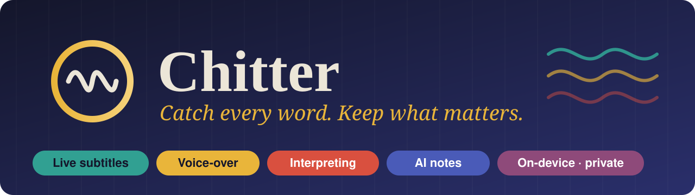
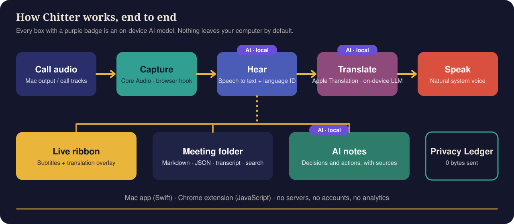
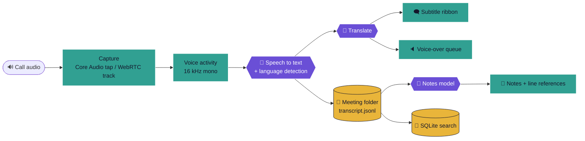
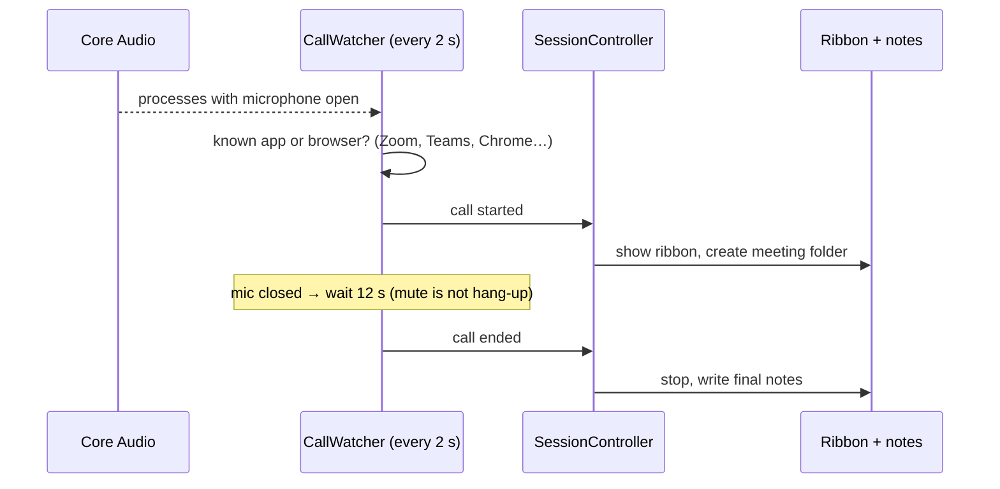
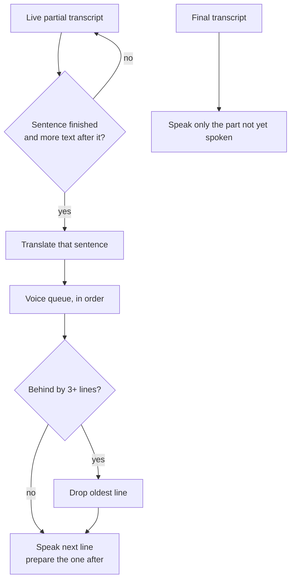
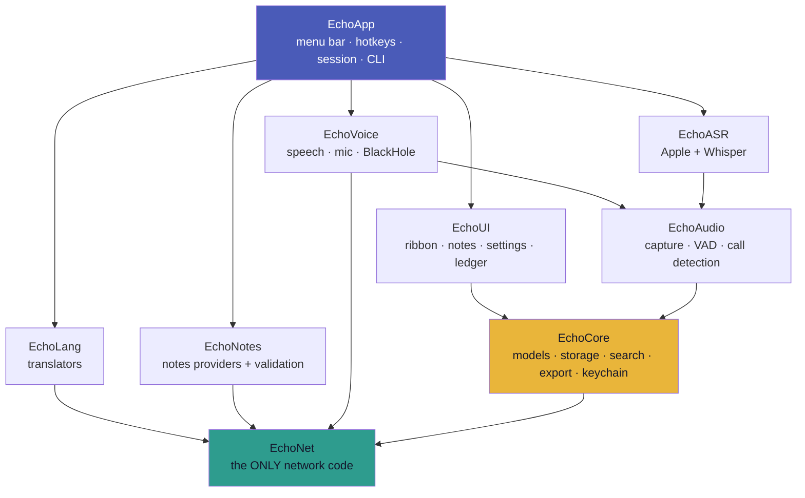
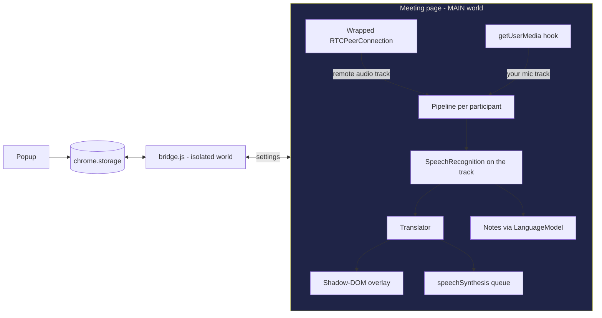

<div align="center"></div>

# 🏗️ Architecture

Chitter is two apps that share one idea: **hear the call, understand it on the device, show and speak the result, and keep the evidence.**

| | 🍎 Mac app | 🌐 Chrome extension |
|---|---|---|
| Language | Swift 6 | JavaScript (Manifest V3) |
| Hears the call by | A Core Audio *process tap* on the Mac's sound output | Hooking the page's WebRTC connection and taking each participant's audio track |
| Runs on | macOS 14.4+ | Chrome 139+ on Windows, Linux, ChromeOS, Mac |
| AI | Apple SpeechAnalyzer, WhisperKit, Apple Translation, Apple on-device language model | Chrome built-in speech, translator, language detector, `LanguageModel` |

<div align="center"></div>

## 1. The pipeline



Purple boxes are AI models. They run on the device unless you add your own cloud key.

## 2. Auto-start: how it knows a call began



The Mac app asks macOS which processes have the microphone open. That works for native apps and for browser tabs without any extension or extra permission.

## 3. Voice-over: how it stays close to live



- `PhraseCommitter` hands out each finished sentence **once**, before the speaker stops talking.
- `DubQueue` keeps order, speeds up to about 1.3× when behind, and **drops** old lines instead of drifting.
- The first call to Apple's on-device model costs about 6 s, so it is warmed up when a call starts.

## 4. Modules (Mac app)



| Module | Job |
|---|---|
| `EchoCore` | Data models, meeting folders, SQLite search, Markdown/SRT/DOCX export, Keychain, settings |
| `EchoAudio` | System-audio tap, resampling, voice-activity detection, call detection |
| `EchoASR` | One `ASREngine` interface; Apple SpeechAnalyzer and WhisperKit behind it; language detection |
| `EchoLang` | `Translator` chain with fallbacks, cool-downs and a cache |
| `EchoNotes` | Notes providers, JSON validation, source-line checking, map-reduce for long meetings, offline fallback |
| `EchoVoice` | Speech synthesis, voice queue, microphone recorder, BlackHole installer (checksum-pinned) |
| `EchoNet` | The single gateway for every network request; writes the Privacy Ledger |
| `EchoUI` | Design tokens, subtitle ribbon, notes window with *Pull the Thread*, settings, onboarding |
| `EchoApp` | Entry point and glue; also the headless test modes used by the benchmark scripts |

## 5. Chrome extension



- Starts **without a click**: a remote audio track appearing means a call is live.
- One pipeline per participant gives each speaker a separate subtitle chip.
- The overlay is built with DOM calls only. Google Meet enforces *Trusted Types*, and an earlier version that set `innerHTML` crashed there; a test now forbids it.
- A test also checks that no source file can make a network request.

## 6. Where data lives

```text
~/Library/Application Support/Chitter/
├── meetings/2026-11-24_2232_zoom-call/
│   ├── meeting.json        title, times, languages
│   ├── transcript.jsonl    one JSON line per sentence, append-only (crash-safe)
│   ├── notes.json / notes.md
│   └── audio.m4a           optional
├── index.sqlite            full-text search across all meetings
└── ledger.jsonl            the Privacy Ledger
```

Folders are `0700`, files `0600`, excluded from Time Machine. Plain files, so the folder opens in Obsidian.

## 7. Key design decisions

| Decision | Why |
|---|---|
| Listen to audio output, not a meeting bot | No one has to be invited; works with any app |
| Everything on-device by default | Privacy, zero running cost, works offline |
| One network gateway, enforced by a test | The Privacy Ledger can then truthfully list every request |
| Provider chains with fallbacks | Free tiers rate-limit and models can be missing; each AI step has a plain-code fallback |
| Reject notes that cite missing lines | An AI model cannot invent its sources |
| Speak finished sentences early | Lowers perceived delay without waiting for the speaker to stop |
| Hook WebRTC instead of capturing the tab (extension) | Chrome only allows tab capture after a click per tab; the hook starts by itself |

See [`../DECISIONS.md`](../DECISIONS.md) for every judgement call.

## 8. Testing

| Where | What |
|---|---|
| `Tests/` (Swift Testing) | Storage, search, export, call detection and hysteresis, phrase committer, voice queue, notes validation, provider fallbacks, checksum, contrast ratios, the rule that only `EchoNet` may use the network |
| `extension/test/test.html` | 13 in-browser checks, including *no network calls* and *no HTML-string injection* |
| `extension/test/smoke.html` | A real in-page WebRTC call under the same Trusted Types rule Meet uses |
| `scripts/bench.sh` | Latency, accuracy, size, 30-minute soak |

## 9. Known limits

- Real call capture on the Mac app and the extension on a live call are not yet verified (see [`PROGRESS.md`](PROGRESS.md)).
- Chrome cannot play audio *into* a call from an extension, so "interpret my voice" is Mac-only.
- The voice-over plays on your speakers only; the original audio keeps playing.
