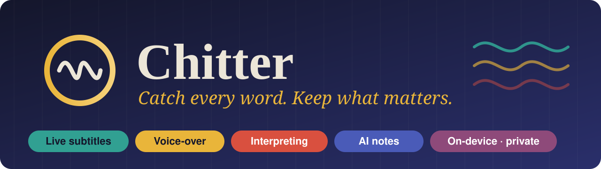

# 💡 Project overview

## The problem
Calls are full of information that is hard to follow and easy to lose:
- Someone speaks a language you don't fully understand, and you only catch part of it.
- Hard-of-hearing users get no captions on many calls.
- After the call, nobody remembers exactly what was decided, or who said it.
- Tools that fix this usually send your meeting to a cloud service, or put a bot in the call.

## The idea
> **Hear the call on the user's own device, show and speak it in their language, and keep notes that prove where they came from.**

Chitter does four things:
1. **Subtitles** for any call or stream.
2. **Voice-over**: foreign speech translated and spoken to you in your language.
3. **Interpreting**: your own voice translated into the call.
4. **Notes with sources**: decisions and action items, each linked to the transcript line.

## 🧠 How I thought about it

| Question | Choice | Reason |
|---|---|---|
| How to hear a call without a bot? | Listen to the computer's audio output (Mac), or the call's audio tracks (browser) | Works with any app, nobody has to be invited |
| Where should AI run? | On the device by default | Privacy, no running cost, works offline |
| Can I trust AI notes? | Make the AI cite transcript lines and reject items that cite nothing real | Lets a person verify, instead of trusting |
| What if a model or service is missing? | Every AI step has a fallback chain ending in plain code | The app never ends up with nothing |
| How to prove "private"? | One network gateway plus a Privacy Ledger window, enforced by a test | A claim you can check |
| Mac only? | Mac app first, then a Chrome extension that works on Windows and Linux | Reach more people with one extra codebase |

## 👥 Who it is for
- **Bilingual and cross-border teams** who switch languages on calls.
- **Students** following lectures and webinars in a second language.
- **Deaf and hard-of-hearing people** who want captions on any audio.
- **Journalists, researchers, lawyers, clinicians**: people who handle sensitive conversations and cannot send them to a cloud service.
- **Language learners** watching streams.

## 💼 Business angle
*These are ideas and reasoning, not measured facts.*

- **Gap in the market:** most meeting-AI products are cloud-based, bot-based, or paid. A free, local-first, source-linked alternative is a clear position.
- **Free core, paid extras (possible model):** keep the app free and open source; charge for managed team deployment, on-premise installs for regulated industries, custom vocabularies, and support.
- **Distribution:** open source on GitHub, Homebrew, a Chrome Web Store listing, and demo videos.
- **Differentiators:** works with any call app, nothing leaves the device, notes you can verify, accessibility built in.
- **Risks to be honest about:** recording-consent laws, dependence on Apple's and Chrome's on-device models, translation quality for less common languages, and platform permission changes.

## 🧾 What was actually built and checked

| Area | Status |
|---|---|
| Speech recognition, language detection, translation, notes, voice synthesis on real audio | ✅ Run for real on test audio (word error rate 2.6% on English; Chinese, Japanese, French, Spanish to English voice) |
| Call detection, phrase committer, voice queue, notes validation, search, export, storage | ✅ Unit-tested |
| Chrome extension logic and a WebRTC loopback call | ✅ 13 browser checks plus a smoke test |
| Live capture of a real call (Mac app), auto-start on a real call, the interpreter's microphone path | ⚠️ Built, **not yet verified** |
| Chrome extension in a real Meet call after the latest fix | ⚠️ **Not yet verified** |

Full per-phase results, including failures: [`PROGRESS.md`](PROGRESS.md).

## 🗣️ How to describe it honestly (for a resume or interview)
- Built a privacy-first, on-device real-time translation and meeting-notes assistant as a native Swift macOS app plus a Chrome extension.
- Designed a provider-chain architecture so every AI step (speech, translation, notes) falls back gracefully when a model or service is unavailable.
- Made AI output verifiable: notes cite transcript lines and the app rejects citations that do not exist.
- Enforced privacy by construction: a single network gateway, a user-visible ledger, and a test that fails the build if any other code touches the network.
- Measured it: accuracy, latency per pipeline stage, and a 30-minute soak test, and documented what is not yet met.

## 🗺️ What's next
See [`ROADMAP.md`](ROADMAP.md): verifying real-call capture on more machines, faster voice-over, a Chrome Web Store release, and a Windows app.
